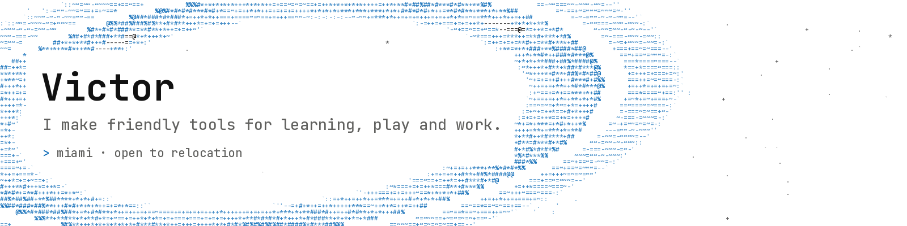

<picture><source media="(prefers-color-scheme: dark)" srcset="assets/header-orbit-dark.png"></picture>

<pre>
<b>live</b>
  <a href="https://gamedeck.gg">GameDeck</a>            your game library, organized and shareable
  <a href="https://coursekit.tools">CourseKit</a>           course reviews in your browser, nothing uploaded
  <a href="https://v2.studio/vbench">vbench</a>              one brief, one try each, scored by hand

<b>open source</b>
  <a href="https://github.com/victorv2i/civil3d-ai-starter">civil3d-ai-starter</a>  describe a Civil 3D command, an agent builds it
  <a href="https://github.com/victorv2i/enkeep">enkeep</a>              a markdown editor in your browser
  <a href="https://github.com/victorv2i/enfold">enfold</a>              shared memory for AI agents, on your machine
  <a href="https://v2.studio/upstream">upstream fixes</a>      2 merged in odysseus, 4 open in hermes-agent

<b>building</b>
  Liquid              a home for your AI agents
  Tutor scorecard     tests AI tutors for answer leaks and privacy slips

<b>elsewhere</b>
  <a href="https://v2.studio">v2.studio</a>  ·  <a href="https://v2.studio/victor-iglesias-resume.pdf">résumé</a>  ·  <a href="https://www.linkedin.com/in/victoriglesiascs/">linkedin</a>  ·  <a href="https://x.com/victorv2i">x</a>
</pre>
